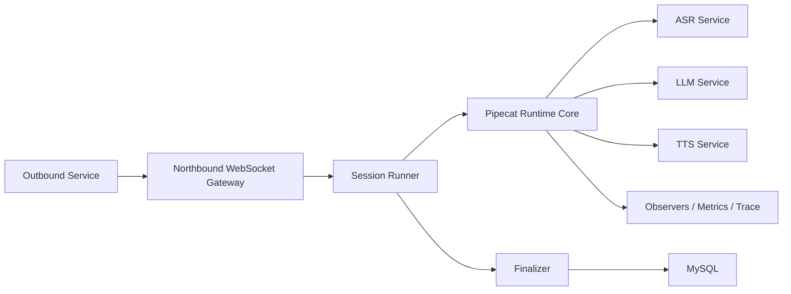
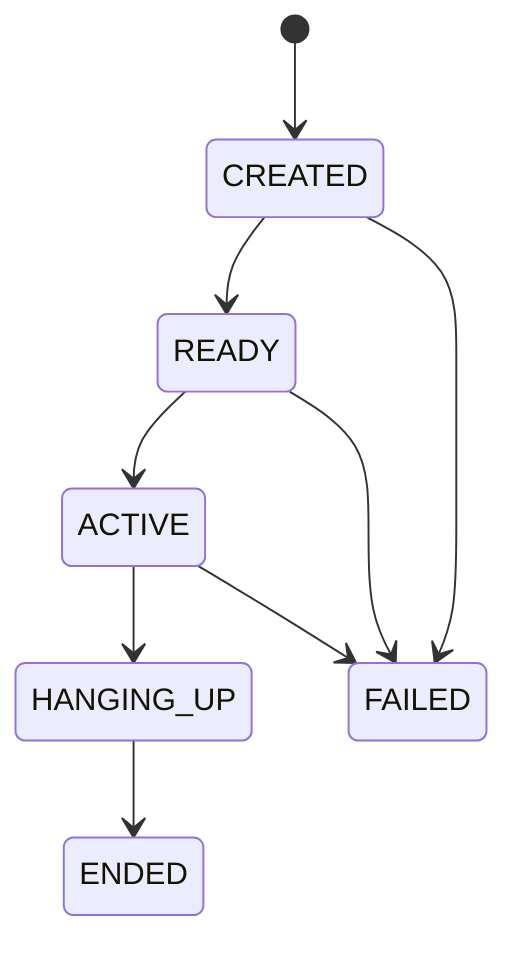

# AGENT_CALL

## 概述

`AGENT_CALL` 的 V1 不是外呼平台。

它不负责：

- 拨号
- SIP 网关管理
- 呼叫调度
- 控制面板
- REST API
- webhook 回调
- 上游工具回传
- 崩溃恢复

它只做一件事：

**在电话接通后，为外呼服务提供一个基于 `pipecat-ai==0.0.104` 的实时 AI 会话服务器。**

一句话：

**外呼服务负责电话，AGENT_CALL 负责 AI 会话。**

## V1 目标

- 对外只暴露一个 WebSocket 接口
- 通过同一个连接完成 AI 会话启动、双向音频传输和最终结果返回
- 转写、turn、provider 指标仅做内部处理和入库，不对外实时暴露
- 通话结束后完成聚合入库，并以 `session.finalized` 作为最终完成信号

## 系统边界

### Outbound Service 负责

- 拨号
- 接听判断
- 电话侧媒体采集与播放
- 在适当时机连接 AI 服务器
- 把电话音频转发给 AI 服务器
- 接收 AI 返回音频并播放给用户

### AGENT_CALL 负责

- 创建实时 AI session
- 初始化 Pipecat runtime
- 接收上游音频
- 生成 AI 音频输出
- 记录内部事件、转写、turn 指标、provider 指标
- 通话结束后完成最终入库
- 返回 `session.ready`、`session.failed`、`session.finalized`

## 总体架构



## 对外协议

### WebSocket

`WS /v1/outbound/session`

V1 的北向协议非常小，只保留：

- 上行：`session.start`、`audio.input`、`session.stop`
- 下行：`session.ready`、`audio.output`、`session.failed`、`session.finalized`

### Media Contract

V1 的媒体协议直接固定为 PCM，不做多编码协商。

固定约束：

- encoding: `pcm_s16le`
- sample_rate: `8000`
- channels: `1`
- transport: WebSocket binary frame

协议约定：

- JSON text frame 只用于控制消息
- binary frame 只用于裸 PCM 音频
- 输入输出默认使用同一媒体格式

V1 不支持：

- wav header
- mp3
- opus
- μ-law / a-law
- 图片或文件类 binary payload

这意味着首期实现可以明确收敛为：

- `session.start / session.stop / session.ready / session.failed / session.finalized` 使用 JSON 文本帧
- `audio.input / audio.output` 使用 WebSocket binary PCM 帧

### 协议边界

北向协议只承担三件事：

- 启动 AI 会话
- 传输双向音频
- 返回失败或最终结果

其余信息只在服务端内部处理并入库，用于排障和分析。

### 上行消息

#### `session.start`

语义：

- 创建 session
- 初始化 Pipecat runtime
- 初始化 provider
- 准备第一轮 AI 通信

V1 默认采用 `bot-first` 模式：

- 收到 `session.start`
- runtime 初始化完成
- 返回 `session.ready`
- 立即触发首轮 bot 发言

因此 `session.ready` 的含义是：

- AI 会话已经准备完成
- 第一轮 AI 通信将立即开始

```json
{
  "type": "session.start",
  "request_id": "req_001",
  "payload": {
    "session_type": "outbound_voice",
    "conversation": {
      "language": "zh-CN",
      "system_prompt": "你是一个电话助手...",
      "initial_messages": [
        {
          "role": "user",
          "content": "请开始通话"
        }
      ]
    },
    "media": {
      "encoding": "pcm_s16le",
      "sample_rate": 8000,
      "channels": 1
    },
    "providers": {
      "asr": {
        "provider": "deepgram",
        "model": "nova-3-general",
        "language": "zh",
        "encoding": "linear16",
        "sample_rate": 8000,
        "channels": 1
      },
      "llm": {
        "provider": "openrouter",
        "model": "openai/gpt-4.1-mini"
      },
      "tts": {
        "provider": "cartesia",
        "model": "sonic-2",
        "voice": "bf32f849-7bc9-4b91-8c62-954588efcc30",
        "language": "zh-CN",
        "encoding": "pcm_s16le",
        "container": "raw"
      }
    },
    "runtime": {
      "barge_in": true,
      "silence_timeout_ms": 6000,
      "max_session_duration_ms": 180000
    },
    "metadata": {
      "tenant_id": "t1",
      "external_ref_id": "biz_123",
      "caller_e164": "+860210000000",
      "callee_e164": "+8613800000000"
    }
  }
}
```

#### `audio.input`

语义：

- 上游持续发送用户侧音频

V1 直接使用 WebSocket binary frame 发送裸 PCM 音频，不定义 JSON 版 `audio.input`。

#### `session.stop`

语义：

- 上游主动通知结束当前 AI 会话

```json
{
  "type": "session.stop",
  "request_id": "req_002",
  "payload": {
    "session_id": "sess_xxx",
    "reason": "upstream_stopped"
  }
}
```

### 下行消息

#### `session.ready`

它不是普通 ack，而是：

- session 已创建
- Pipecat runtime 已初始化
- provider 已可用
- 第一轮 AI 通信即将开始

```json
{
  "type": "session.ready",
  "session_id": "sess_xxx",
  "trace_id": "trace_xxx",
  "timestamp": "2026-04-08T12:30:00.123Z",
  "payload": {
    "media": {
      "encoding": "pcm_s16le",
      "sample_rate": 8000,
      "channels": 1
    }
  }
}
```

#### `audio.output`

语义：

- AI 服务器持续输出机器人侧音频

V1 直接使用 WebSocket binary frame 返回裸 PCM 音频，不定义 JSON 版 `audio.output`。

#### `session.failed`

语义：

- 本次 AI 会话失败，无法继续

```json
{
  "type": "session.failed",
  "session_id": "sess_xxx",
  "trace_id": "trace_xxx",
  "timestamp": "2026-04-08T12:31:00.123Z",
  "payload": {
    "status": "FAILED",
    "termination_code": "provider_error"
  }
}
```

#### `session.finalized`

它是最终结果信号。

只有收到它，才表示：

- 会话已经结束
- runtime 已收口
- 核心指标已聚合
- 数据已写入 MySQL

```json
{
  "type": "session.finalized",
  "session_id": "sess_xxx",
  "trace_id": "trace_xxx",
  "timestamp": "2026-04-08T12:31:05.123Z",
  "payload": {
    "status": "ENDED",
    "termination_code": "normal_end",
    "turn_count": 6,
    "total_duration_ms": 65000
  }
}
```

## 核心运行模型

### Session Runner

V1 只保留一个最小 `Session Runner`，每个 WebSocket 会话对应一个运行中的 AI session。

它负责：

- 解析 `session.start`
- 创建 `session_id` 和 `trace_id`
- 初始化 Pipecat runtime
- 接收上游音频并送入 runtime
- 把 runtime 音频返回给上游
- 在结束时调用 Finalizer

#### 状态机

- `CREATED`
- `READY`
- `ACTIVE`
- `HANGING_UP`
- `ENDED`
- `FAILED`



### Pipecat Runtime

`Pipecat Runtime` 是 V1 唯一的实时会话内核。

直接依赖 Pipecat 的能力：

- `Pipeline`
- `PipelineTask`
- `transport.input()` / `transport.output()`
- `LLMContext`
- context aggregators
- interruptions / barge-in
- `AudioBufferProcessor`
- observers / metrics / tracing

推荐 pipeline：

```text
transport.input()
-> stt_service
-> context_aggregator.user()
-> llm_service
-> tts_service
-> transport.output()
-> context_aggregator.assistant()
-> audio_buffer_processor
```

推荐参数：

```python
PipelineParams(
    allow_interruptions=True,
    enable_metrics=True,
    enable_usage_metrics=True,
    enable_tracing=True,
)
```

推荐 observers：

- `MetricsLogObserver`
- `TurnTrackingObserver`
- `UserBotLatencyObserver`
- `StartupTimingObserver`

这些 observers 只用于内部指标聚合和入库，不直接作为北向协议消息下发。

## 现有模板重构方案

### 重构目标

将现有“电话网关事件直连 bot”的单体脚本，重构为“单 WebSocket AI 会话服务器”。

保留 Pipecat 和 WebSocket 的稳定技术骨架，替换协议层、会话边界和最终落库方式。

### 保留组件

- `FastAPIWebsocketTransport`
- 自定义 `FrameSerializer`
- Pipecat `Pipeline` / `PipelineTask`
- `LLMContext` / aggregators
- observer / metrics collector 模式
- PCM16 校验和采样率转换逻辑

### 替换组件

| 现有模板 | V1 新方案 |
| --- | --- |
| `CustomProtocolFrameSerializer` | `SessionProtocolFrameSerializer` |
| `TelephonyEventFrame` | `SessionControlFrame` / `UpstreamControlFrame` |
| `TelephonyEventRouter` | `SessionMessageRouter` |
| `on_answer -> queue LLMRunFrame()` | `session.start -> session.ready -> 首轮 AI 通信` |
| 业务型 `config_manager` | 通用 `session.start.payload` |
| `CallMetricsCollector.save_to_db()` | `Finalizer` 写 5 张核心表 |

### 删除组件

- `ring/answer/hangup/dtmf/talk` 这类北向电话事件协议
- “电话网关事件直接驱动 bot 业务”的模式
- 与催收/营销绑定的配置解析
- `send_hangup_signal()` 这类电话控制职责
- 单体式尾处理落库逻辑

### 模块拆分

现有 `run_bot_beta()` 应拆成：

- `create_runtime_context()`
- `create_services()`
- `create_transport()`
- `create_pipeline()`
- `run_session()`
- `finalize_session()`

### 新执行流程

```text
WebSocket connected
-> receive session.start
-> validate payload
-> create session_id / trace_id
-> build services
-> build pipeline
-> send session.ready
-> receive audio.input (binary)
-> Pipecat runtime process
-> send audio.output (binary)
-> receive session.stop or natural end
-> finalize metrics and storage
-> send session.finalized
```

## 代码边界

### Provider 层

provider 层只定义两个扩展点：

```python
class PipecatServiceFactory: ...
class ProviderRouter: ...
```

作用：

- `PipecatServiceFactory`：根据配置创建 STT / LLM / TTS service
- `ProviderRouter`：决定当前 session 该用哪个 provider

原则：

- ASR / LLM / TTS 优先实例化 Pipecat 原生 service
- 若目标 provider 没有可直接复用的 Pipecat service，则由平台补最薄 custom adapter
- provider 层只负责“创建谁”和“选择谁”，不负责北向协议适配

V1 当前优先联调 provider 组合：

- ASR：Deepgram
- LLM：OpenRouter（OpenAI 兼容）
- TTS：Cartesia

V1 已移除 `reference-*` provider。若传入非上述 provider，会收到 `session.failed`（`termination_code=provider_error`）。

### Transport 适配层

`SessionTransportAdapter` 不属于 provider 层，而属于北向协议与 runtime 之间的桥接层。

```python
class SessionTransportAdapter: ...
```

它负责：

- 解析 `session.start`
- 接收 `audio.input`
- 校验和转换 PCM 音频帧
- 将上游消息适配成 Pipecat transport 可消费的输入
- 将 Pipecat 输出音频适配成 `audio.output`

简化理解：

- `gateway/` 管“怎么收发 WebSocket”
- `SessionTransportAdapter` 管“这些消息如何接到 runtime 上”
- `providers/` 管“STT / LLM / TTS 用哪个服务”

## 存储设计

V1 只保留 5 张核心表：

- `session_record`
- `event_log`
- `session_turn_metrics`
- `session_provider_metrics`
- `transcript_log`

### `session_record`

作用：

- 一通 session 一行
- 保存最终执行结果
- 作为查询入口和总账

建议字段：

- `session_id`
- `trace_id`
- `status`
- `termination_code`
- `caller_e164`
- `callee_e164`
- `language`
- `created_at`
- `started_at`
- `ended_at`
- `total_duration_ms`
- `turn_count`
- `provider_failover_count`
- `total_cost_usd`
- `metadata_json`

### `event_log`

作用：

- 保存内部关键事件流水
- 用于排障、审计和过程追踪

建议事件：

- `session.created`
- `session.ready`
- `runtime.started`
- `runtime.failed`
- `session.ended`
- `session.failed`
- `session.finalized`

### `session_turn_metrics`

作用：

- 保存每一轮对话的关键延迟和行为
- 支撑 TTFB、turn latency、interrupt 分析

建议字段：

- `turn_id`
- `turn_index`
- `speaker`
- `turn_started_at`
- `turn_ended_at`
- `interrupted`
- `asr_first_final_ms`
- `llm_first_token_ms`
- `tts_first_chunk_ms`
- `end_to_end_turn_latency_ms`

### `session_provider_metrics`

作用：

- 汇总每种 provider 在当前 session 内的表现
- 用于看延迟、重连、失败和成本

建议字段：

- `capability`
- `provider_name`
- `model_name`
- `connect_attempts`
- `reconnect_count`
- `failover_count`
- `avg_ttfb_ms`
- `max_ttfb_ms`
- `cost_usd`

### `transcript_log`

作用：

- 保存转写结果
- 用于审计、分析和后续质检

建议字段：

- `session_id`
- `turn_id`
- `speaker`
- `transcript_type`
- `text`
- `confidence`
- `audio_start_ms`
- `audio_end_ms`

## 入库时机

实时写入：

- `event_log`：关键内部事件产生时写入
- `transcript_log`：final transcript 产生时写入
- `session_turn_metrics`：每轮结束时写入或更新

结束聚合：

- `session_provider_metrics`：会话结束后由 `Finalizer` 聚合写入
- `session_record`：会话结束后由 `Finalizer` 最终写入

`Finalizer` 的职责只包括结束阶段的聚合与最终写入，不负责实时流水写入。

结束顺序：

1. 收到 `session.stop` 或内部结束策略触发结束
2. Pipecat runtime 停止输出
3. observers 收口
4. Finalizer 聚合指标
5. 写入 MySQL
6. 返回 `session.finalized`

内部结束策略包括：

- runtime 超时
- 静音超时
- provider 错误
- 不可恢复的会话错误

## 故障边界

V1 明确不做：

- 进程崩溃后的会话恢复
- 进程崩溃后的补偿入库
- 断线后续传原会话

因此 V1 适合：

- 任务式 AI 通话
- 单连接实时交互
- 上游可接受“连接断了，本次会话失败”

不适合：

- 强可靠投递
- 崩溃自动补账
- 多端控制
- 复杂运营平台

## 推荐目录

V1 的目录围绕 6 个核心边界收缩：

- `gateway`：WebSocket 协议接入
- `session`：单 session 生命周期
- `runtime`：Pipecat runtime 装配
- `providers`：provider 创建与选路
- `storage`：落库与 finalizer
- `schemas`：消息和配置契约

```text
AGENT_CALL/
  app.py
  gateway/
    websocket.py
    protocol.py
    serializer.py
  session/
    runner.py
    state_machine.py
    registry.py
    context.py
  runtime/
    pipeline_factory.py
    observers.py
    metrics.py
    transport.py
  providers/
    factory.py
    router.py
    registry.py
  schemas/
    messages.py
    session.py
    provider.py
    event.py
  storage/
    models.py
    repositories.py
    finalizer.py
```

## 总结

V1 的正确形态应该是：

**外呼服务在电话接通后，通过一个 WebSocket 把实时音频接给 AGENT_CALL；AGENT_CALL 基于 Pipecat 完成整段 AI 会话，并在结束后入库，再返回 `session.finalized`。**

## 本地联调检查清单

### `.env` 最小配置

```env
DB_DIALECT=mysql
DB_HOST=localhost
DB_PORT=3306
DB_USER=root
DB_PASSWORD=your_mysql_password
DB_NAME=AGENT_CALL
DB_CHARSET=utf8mb4

DEEPGRAM_API_KEY=...
OPENROUTER_API_KEY=...
CARTESIA_API_KEY=...
CARTESIA_VOICE_ID=bf32f849-7bc9-4b91-8c62-954588efcc30
```

### 启动前置

```bash
./.venv/bin/alembic upgrade head
./.venv/bin/python app.py
```

### 正常链路日志关键点

- `DeepgramSTTService`
- `OpenAILLMService`
- `CartesiaTTSService`

如果日志中没有上述 3 个服务名，优先检查 `session.start.providers` 是否传成了 `deepgram + openrouter + cartesia`。
