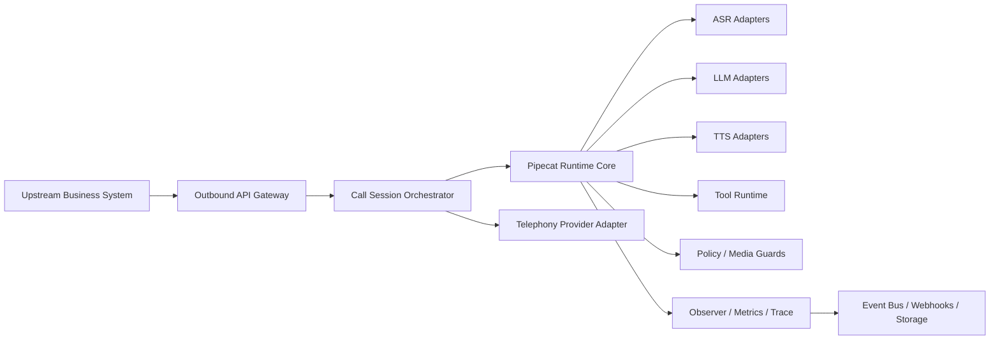
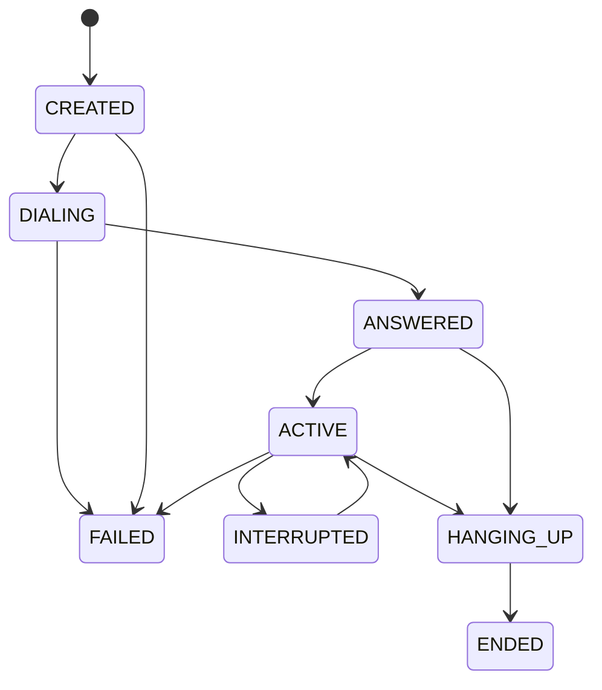

# AGENT_CALL

## 定位

`AGENT_CALL` 不是业务会话平台，也不是场景化机器人平台。

它是一个通用的实时外呼与会话执行引擎，负责把电话打通、媒体跑通、对话跑通、事件打全，并向上游暴露统一的会话控制与可观测能力。

它只提供：

- session 生命周期管理
- 实时媒体流处理
- turn-taking / barge-in / interruption
- provider orchestration
- tool execution runtime
- trace / metrics / audit
- callback / event stream

它不提供：

- 催收逻辑
- 客服逻辑
- 营销逻辑
- 任何业务场景封装

业务系统需要自己传入 prompt、tools、provider 配置、metadata、回调地址。引擎不理解业务语义，只执行会话。

## Pipecat-First 原则

这套方案的实时 runtime 内核应明确绑定到 `pipecat-ai==0.0.104`。

边界应该这样划：

- Pipecat 负责：pipeline、frames、context aggregation、function calling、turn-taking、metrics、tracing、audio buffering
- 平台负责：session orchestration、telephony 外呼控制、provider 路由与恢复、事件桥接、最终落库

默认原则：

> 能直接通过 Pipecat 的 service、aggregator、observer、frame、transport 参数实现的能力，不再额外抽象成平台自研模块。

## 设计原则

- 业务无关：不固化业务话术、字段、结果枚举、流程节点
- 会话优先：所有能力围绕 `session` 编排、跟踪和结算
- 媒体优先：电话接通、音频稳定、低延迟响应优先于复杂业务抽象
- 事件优先：所有关键动作都转换为标准事件流供上游消费
- 多云可插拔：ASR、LLM、TTS、Telephony 均通过统一适配层接入
- 可恢复：支持 provider 重连、运行时恢复、终态补偿、幂等落库
- 可审计：所有关键决策、媒体处理、工具调用都可追踪
- Pipecat-first：优先复用 `pipecat-ai==0.0.104` 原生能力，平台层尽量保持薄

## 总体架构



从职责上可以拆成四个平面：

1. Control Plane  
   `Outbound API Gateway` + `Call Session Orchestrator`，负责创建、控制、终止 session。

2. Media Plane  
   `Telephony Transport` + `Pipecat Runtime`，负责音频输入输出、流式处理、turn-taking。

3. Intelligence Plane  
   `ASR / LLM / TTS / Tool Runtime / Policy`，负责识别、生成、工具调用和底层策略。

4. Observability Plane  
   `Metrics / Trace / Event Bus / Storage`，负责指标、审计、日志、回调与最终落库。

## 重新收缩后的职责边界

如果核心 runtime 采用 `pipecat-ai==0.0.104`，下面这些不应继续作为平台的重模块存在：

- 自研 `TurnManagerProcessor`
- 自研 `ContextAggregator`
- 自研 `PromptInjectorProcessor`
- 自研通用 `ToolCallProcessor`
- 自研一套平行的 metrics / tracing 主链路
- 自研一套平行的 interruption / silence runtime

这些能力应优先复用 Pipecat 自身能力：

- `LLMContext` 与 context aggregators
- `UserTurnStrategies`
- LLM service 的 function calling
- `PipelineParams(enable_metrics=True, enable_usage_metrics=True, enable_tracing=True)`
- `MetricsFrame`
- `MetricsLogObserver`
- `TurnTrackingObserver`
- `UserBotLatencyObserver`
- `StartupTimingObserver`
- `AudioBufferProcessor`

平台应该保留的自研模块只有：

- `Outbound API Gateway`
- `Call Session Orchestrator`
- `Telephony Provider Adapter`
- `Provider Router / Recovery Supervisor`
- `Webhook / Event Bus Bridge`
- `Storage Finalizer`

## 核心能力边界

### 输入

上游通过 API 指定：

- 拨叫对象
- 通道与 transport
- 音频格式
- prompt 和初始消息
- tools schema
- provider 选择和配置
- runtime 策略参数
- metadata / callback / tracing

### 输出

引擎提供：

- session 状态
- 实时事件流
- 转写流
- 工具调用事件
- 运行时指标
- 最终执行汇总

### 不输出

引擎不直接输出业务判定，例如：

- 是否有还款意愿
- 是否是高意向客户
- 是否命中营销标签
- 是否应该转人工销售

这些都应由上游根据 transcript、tool 结果和 event 流自行判断。

## API 风格

系统对上游只暴露三类接口：

1. Create Session
2. Stream Media / Events
3. Control Session

### 1. Create Session

`POST /v1/outbound/sessions`

```json
{
  "session_type": "outbound_voice",
  "callee": "+8613800000000",
  "caller": "+860210000000",
  "transport": {
    "provider": "sip_gateway_x",
    "mode": "phone_call",
    "config": {
      "trunk_id": "trunk_a"
    }
  },
  "media": {
    "input_format": "pcm_s16le",
    "output_format": "pcm_s16le",
    "sample_rate": 8000,
    "channels": 1
  },
  "conversation": {
    "language": "zh-CN",
    "system_prompt": "你是一个电话助手...",
    "initial_messages": [
      {
        "role": "user",
        "content": "请开始通话"
      }
    ],
    "tools": [
      {
        "name": "end_call",
        "description": "End current call",
        "parameters": {
          "type": "object",
          "properties": {}
        }
      }
    ]
  },
  "providers": {
    "asr": {
      "provider": "tencent",
      "model": "xxx"
    },
    "tts": {
      "provider": "aliyun",
      "voice": "xxx"
    },
    "llm": {
      "provider": "volcengine",
      "model": "xxx"
    }
  },
  "runtime": {
    "barge_in": true,
    "silence_timeout_ms": 6000,
    "max_session_duration_ms": 180000,
    "provider_retry_budget": {
      "asr": 3,
      "llm": 2,
      "tts": 3
    }
  },
  "callbacks": {
    "event_webhook_url": "https://example.com/callbacks/events",
    "tool_webhook_url": "https://example.com/callbacks/tools"
  },
  "metadata": {
    "tenant_id": "t1",
    "source_system": "crm_x",
    "external_ref_id": "b123",
    "trace_id": "optional-trace"
  }
}
```

返回：

```json
{
  "session_id": "sess_xxx",
  "trace_id": "trace_xxx",
  "status": "CREATED"
}
```

### 2. Stream Media / Events

对上游暴露：

- `GET /v1/outbound/sessions/{session_id}`：查询 session 当前状态
- `GET /v1/outbound/sessions/{session_id}/events`：拉取事件流
- `GET /v1/outbound/sessions/{session_id}/transcripts`：拉取转写
- Webhook / Event Bus：实时推送事件
- 可选 SSE / WebSocket：给控制台或运维系统订阅

### 3. Control Session

- `POST /v1/outbound/sessions/{session_id}/actions/hangup`
- `POST /v1/outbound/sessions/{session_id}/actions/context`
- `POST /v1/outbound/sessions/{session_id}/actions/tool-results`
- `POST /v1/outbound/sessions/{session_id}/actions/handoff`
- `POST /v1/outbound/sessions/{session_id}/actions/retry-provider`

这些接口只控制会话，不表达任何业务场景。

## Session Orchestrator

`Call Session Orchestrator` 负责启动、驱动、恢复和结束一通电话，但不理解 prompt 的业务含义，也不接管 Pipecat 内部的上下文聚合和 turn 逻辑。

职责：

- 创建 session 与 trace 上下文
- 校验请求并冻结 provider/runtime 快照
- 分配 runtime worker
- 建立 telephony 连接
- 组装并启动 Pipecat pipeline
- 管理 session 状态机
- 处理挂断、超时、重试、故障转移、人工接管
- 落地最终执行结果

### 推荐状态机



状态说明：

- `CREATED`：已创建，未发起外呼
- `DIALING`：呼叫中，等待接通
- `ANSWERED`：对端已接听，媒体协商完成前的短暂状态
- `ACTIVE`：双向音频和对话均可用
- `INTERRUPTED`：发生打断、provider 抖动或短暂恢复期
- `HANGING_UP`：已进入结束流程，停止新增输出
- `ENDED`：正常终态
- `FAILED`：异常终态

### 终态原因建议

建议将终态原因统一收敛为执行级枚举，而不是业务级枚举：

- `normal_hangup`
- `callee_hangup`
- `caller_hangup`
- `system_hangup`
- `timeout`
- `voicemail`
- `provider_error`
- `provider_unavailable`
- `transport_error`
- `tool_timeout`
- `policy_terminated`
- `max_duration_reached`

## Pipecat Runtime

`Pipecat Runtime` 是整个系统的实时内核，应该尽量直接复用 `pipecat-ai==0.0.104` 的原生编排能力，而不是在平台里再自建一套等价 runtime。

推荐 pipeline：

```text
transport.input()
-> stt_service
-> context_aggregator.user()
-> llm_service
-> tts_service
-> transport.output()
-> context_aggregator.assistant()
-> audio_buffer_processor (optional)
```

### 优先依赖的 Pipecat 内置能力

- `Pipeline` / `PipelineTask`
- `FrameProcessor` 体系
- `transport.input()` / `transport.output()`
- `LLMContext`
- `LLMContextAggregatorPair`
- `LLMUserAggregatorParams`
- `UserTurnStrategies`
- LLM function calling
- `AudioBufferProcessor`
- observers + tracing + metrics

### 平台只保留的薄扩展

- telephony 边界上的 codec / payload 适配
- 非 Pipecat 原生 provider 的薄适配
- voicemail / hangup 这类执行级策略
- provider recovery / failover
- 事件桥接与最终入库

### 推荐装配方式

```python
task = PipelineTask(
    Pipeline([
        transport.input(),
        stt_service,
        context_aggregator.user(),
        llm_service,
        tts_service,
        transport.output(),
        context_aggregator.assistant(),
        audio_buffer_processor,
    ]),
    params=PipelineParams(
        allow_interruptions=True,
        enable_metrics=True,
        enable_usage_metrics=True,
        enable_tracing=True,
    ),
    observers=[
        MetricsLogObserver(),
        TurnTrackingObserver(),
        UserBotLatencyObserver(),
        StartupTimingObserver(),
    ],
)
```

真正需要自定义 processor 的场景应尽量少，只保留 Pipecat 原生能力无法覆盖的协议边界或审计边界。

## Provider Layer

Provider 仍按能力拆，但如果以 Pipecat 0.0.104 为核心，`ASR / LLM / TTS` 更适合做成 Pipecat service factory，而不是平台自定义统一流式协议。

```python
class PipecatServiceFactory: ...
class TelephonyProviderAdapter: ...
class ProviderRouter: ...
```

### 统一注册表

```python
provider_registry.resolve("asr", "tencent")
provider_registry.resolve("tts", "aliyun")
provider_registry.resolve("llm", "volcengine")
provider_registry.resolve("telephony", "sip")
```

### 推荐接口骨架

```python
class PipecatServiceFactory:
    def create_stt(self, config: dict):
        ...

    def create_llm(self, config: dict):
        ...

    def create_tts(self, config: dict):
        ...


class TelephonyProviderAdapter:
    async def create_transport(self, config: dict):
        ...

    async def dial(self, callee: str, caller: str, config: dict) -> dict:
        ...

    async def hangup(self, session_id: str, reason: str) -> None:
        ...


class ProviderRouter:
    def resolve_primary(self, capability: str, config: dict):
        ...

    def resolve_fallbacks(self, capability: str, config: dict):
        ...
```

实现原则：

- Pipecat 已原生支持的 ASR / LLM / TTS provider，直接实例化 Pipecat service
- Pipecat 尚未覆盖的云厂商，才补最薄的一层 adapter
- Telephony 仍由平台层掌握，因为拨号、SIP trunk、网关接入、接听状态通常不属于 Pipecat 的通用能力边界

### 支持的 provider 类型

- ASR：腾讯云、阿里云、火山引擎、Deepgram
- TTS：腾讯云、阿里云、火山引擎、Cartesia
- LLM：腾讯云、阿里云、火山引擎、OpenAI、OpenRouter
- Telephony：SIP、云呼叫网关、WebSocket 话机

## 重连、重试与故障转移

生产环境里，TTFB 和 provider 重连不能只当作监控项，它们必须进入 runtime 设计。

### Connection Supervisor

建议把统一的 `ConnectionSupervisor` 放在 Pipecat task 外层，作为 session/runtime supervisor，而不是再做成 pipeline 内核心 processor。

- 记录每个 provider 或 transport 的连接状态
- 记录首次建连耗时
- 记录断开原因和重连原因
- 按 capability 执行重试预算
- 超过预算后重建 Pipecat service / transport 或触发 failover
- 把所有行为写入 event / metrics / audit

### 建议连接状态

- `idle`
- `connecting`
- `ready`
- `degraded`
- `reconnecting`
- `failed`
- `closed`

### 建议策略

- 重试预算：每类 provider 独立配置
- 指数退避：`base_delay_ms * 2^n`，带随机抖动
- 熔断窗口：短时间连续失败后暂停路由到该 provider
- failover 顺序：由 session 请求或平台默认策略给出
- 幂等恢复：同一 turn 在 retry/failover 下不能重复入账

### 需要显式统计的字段

- `connect_attempts`
- `reconnect_count`
- `connect_success_count`
- `connect_failure_count`
- `failover_count`
- `last_error_code`
- `last_error_message`
- `last_disconnect_at`
- `total_downtime_ms`

## TTFB 与延迟指标设计

`TTFB` 必须成为一等公民，且要按 turn、按 provider、按 session 汇总。

但这里应优先依赖 Pipecat 内置 metrics，而不是平台自己从零测一套。

建议直接利用：

- `PipelineParams(enable_metrics=True)`
- `PipelineParams(enable_usage_metrics=True)`
- `MetricsFrame`
- `MetricsLogObserver`
- `UserBotLatencyObserver`
- `TurnTrackingObserver`
- OpenTelemetry tracing

### 推荐指标定义

- `dial_to_answer_ms`  
  从发起拨号到对端接听。

- `asr_first_partial_ms`  
  用户开始说话到收到首个 partial transcript。

- `asr_first_final_ms`  
  用户开始说话到收到 final transcript。

- `llm_first_token_ms`  
  LLM 请求发出到收到首个 token / 首个 delta。

- `tts_first_chunk_ms`  
  TTS 请求发出到收到首个音频 chunk。

- `agent_first_audio_ms`  
  ASR final 可用到首个机器人音频发出。

- `end_to_end_turn_latency_ms`  
  用户 turn 结束到机器人首包音频发出。

### 平台该做什么

平台层主要做两件事：

- 把 Pipecat metrics / tracing 映射成统一事件模型
- 把 turn 级和 provider 级指标最终聚合入库

### 为什么不要只存 `ttfb_list`

列表可以保留，但生产设计不应只存数组：

- 数组不利于按 turn 检索
- 数组不利于关联 provider failover
- 数组不利于统计 p95/p99
- 数组不能表达 retry 前后哪次请求生效

更合理的方式是：

- 在 `session_turn_metrics` 中逐轮记录
- 在 `session_provider_metrics` 中汇总平均值、分位值、最大值
- 需要兼容历史消费时，再派生 `ttfb_list` 视图或物化字段

## Tool Runtime

工具能力保持业务无关，但实现上应尽量建立在 Pipecat 的 function calling 上。

上游通过 session 创建接口传入 tool schema。平台只负责：

- 将 tool schema 放入 `LLMContext`
- 提供 webhook/plugin 两类函数执行桥接
- 接收函数调用事件并记录审计
- 将结果写回 session 和存储
- 发出标准工具事件

不要把工具执行重新做成一套独立对话 runtime。Pipecat 已经覆盖：

- function schema 注入
- LLM 触发函数调用
- function result 回写上下文
- 与消息历史的关联

### 两种执行模式

1. `webhook tool`  
   调用上游业务系统，由上游返回结果。

2. `local plugin tool`  
   调用本地插件 worker，适合低延迟系统能力。

### 工具执行生命周期

- `tool.call.requested`
- `tool.call.dispatched`
- `tool.call.completed`
- `tool.call.failed`
- `tool.call.timeout`

### 工具执行要求

- 有超时
- 有幂等键
- 有最大重试次数
- 可追踪 request/response
- 结果写回 session context 时必须带版本号

## Policy / Guard 层

底层执行平台应只保留媒体与会话行为策略，不参与业务判断；并且优先把策略做成 Pipecat 参数或 observer，而不是新增很多 processor。

建议内置策略：

- `AudioPayloadGuard`
- `VoicemailPolicy`
- `HangupPolicy`
- `ProviderFallbackPolicy`
- `MaxDurationPolicy`
- `ReconnectBudgetPolicy`

### 策略职责

- `AudioPayloadGuard`：只处理 telephony 边界上的协议和音频有效性
- `VoicemailPolicy`：检测语音信箱或录音提示，必要时提前终止 session
- `HangupPolicy`：把执行级终态映射为 Pipecat 结束动作和 telephony hangup
- `ProviderFallbackPolicy`：决定何时重建 service 或切换 fallback provider
- `MaxDurationPolicy`：会话硬超时
- `ReconnectBudgetPolicy`：限制异常状态下的无限重连

下面这些则优先交给 Pipecat 配置：

- interruption / barge-in
- user turn start / stop
- silence 收口
- context 聚合
- function call 生命周期
- 基础 metrics 和 tracing

## 标准事件模型

平台对上游最有价值的输出不是场景能力，而是标准事件流。

### 事件信封

```json
{
  "event_id": "evt_xxx",
  "session_id": "sess_xxx",
  "trace_id": "trace_xxx",
  "sequence": 1024,
  "event_type": "llm.response.completed",
  "occurred_at": "2026-04-07T12:30:00.123Z",
  "source": "runtime.llm",
  "turn_id": "turn_05",
  "provider": {
    "capability": "llm",
    "name": "openai",
    "instance": "primary"
  },
  "payload": {}
}
```

### 推荐标准事件

- `session.created`
- `session.started`
- `session.ended`
- `session.failed`
- `call.dialing`
- `call.answered`
- `call.hangup.requested`
- `call.hung_up`
- `media.input.started`
- `media.output.started`
- `audio.filtered`
- `turn.started`
- `turn.ended`
- `interruption.detected`
- `silence.detected`
- `voicemail.detected`
- `transcription.partial`
- `transcription.final`
- `llm.request.started`
- `llm.response.started`
- `llm.response.completed`
- `tts.request.started`
- `tts.started`
- `tts.completed`
- `provider.connecting`
- `provider.connected`
- `provider.reconnecting`
- `provider.failover`
- `provider.failed`
- `tool.call.requested`
- `tool.call.completed`
- `tool.call.failed`

### 事件要求

- 全局递增 `sequence`
- 至少一次投递
- 幂等消费
- 可回放
- 支持按 `session_id`、`trace_id`、`event_type` 检索

## 通用存储模型

平台只存“会话执行数据”，不存业务对象。

### 存储分层

建议至少拆成六张表：

1. `session_record`：会话最终汇总，通话结束后补齐
2. `session_provider_metrics`：按 provider 能力维度汇总
3. `session_turn_metrics`：按 turn 记录时延和行为
4. `event_log`：全量标准事件
5. `transcript_log`：partial/final 转写记录
6. `tool_call_log`：工具调用明细
7. `media_audit`：音频审计和媒体文件索引，可选

### 为什么不建议把所有字段塞一张表

- 实时写热点太高
- JSON 和明细字段会膨胀
- 难以支持审计和回放
- 难以统计 TTFB、重连、failover
- 无法兼容 partial transcript 和多次工具调用

## 通用字段设计

下面给出一套更通用、去业务化的 MySQL 字段方案。

### 1. `session_record`

会话最终汇总。主张“一通电话一行”。

| 字段名 | MySQL 类型 | 必填 | 说明 |
| --- | --- | --- | --- |
| `id` | BIGINT AUTO_INCREMENT | yes | 自增主键 |
| `session_id` | VARCHAR(64) | yes | 平台 session ID，唯一 |
| `trace_id` | VARCHAR(64) | yes | 链路追踪 ID |
| `tenant_id` | VARCHAR(64) | no | 租户 ID |
| `source_system` | VARCHAR(64) | no | 上游来源系统 |
| `external_ref_id` | VARCHAR(128) | no | 上游业务关联 ID |
| `session_type` | VARCHAR(32) | yes | `outbound_voice` 等 |
| `direction` | VARCHAR(16) | yes | `outbound` |
| `status` | VARCHAR(32) | yes | 终态状态，`ENDED` / `FAILED` |
| `termination_code` | VARCHAR(64) | yes | 执行级终止原因 |
| `termination_detail` | VARCHAR(255) | no | 终止细节 |
| `caller_e164` | VARCHAR(32) | yes | 主叫号码 |
| `callee_e164` | VARCHAR(32) | yes | 被叫号码 |
| `language` | VARCHAR(16) | no | 会话语言 |
| `telephony_provider` | VARCHAR(64) | yes | 电话通道 provider |
| `asr_provider` | VARCHAR(64) | no | ASR provider |
| `llm_provider` | VARCHAR(64) | no | LLM provider |
| `tts_provider` | VARCHAR(64) | no | TTS provider |
| `telephony_target` | VARCHAR(64) | no | trunk / gateway / route 标识 |
| `created_at` | DATETIME(3) | yes | session 创建时间 |
| `dialing_started_at` | DATETIME(3) | no | 开始拨号时间 |
| `answered_at` | DATETIME(3) | no | 接听时间 |
| `active_at` | DATETIME(3) | no | 进入 ACTIVE 时间 |
| `ended_at` | DATETIME(3) | yes | 结束时间 |
| `total_duration_ms` | BIGINT | yes | 创建到结束总时长 |
| `ringing_duration_ms` | BIGINT | no | 拨号到接听时长 |
| `active_duration_ms` | BIGINT | no | 通话活跃时长 |
| `turn_count` | INT | yes | 总轮次 |
| `user_turn_count` | INT | yes | 用户轮次 |
| `assistant_turn_count` | INT | yes | 机器人轮次 |
| `interrupt_count` | INT | yes | 打断次数 |
| `silence_event_count` | INT | yes | 静默事件次数 |
| `voicemail_detected` | TINYINT(1) | yes | 是否语音信箱 |
| `human_handoff_requested` | TINYINT(1) | yes | 是否请求人工接管 |
| `hangup_by` | VARCHAR(32) | no | `callee` / `caller` / `system` |
| `max_concurrent_provider_errors` | INT | yes | 峰值并发 provider 错误数 |
| `provider_reconnect_count` | INT | yes | provider 重连总次数 |
| `provider_failover_count` | INT | yes | provider 故障切换总次数 |
| `tool_call_count` | INT | yes | 工具调用次数 |
| `total_cost_usd` | DECIMAL(12,6) | yes | 全链路总成本 |
| `provider_snapshot_json` | JSON | yes | provider 配置快照 |
| `runtime_snapshot_json` | JSON | yes | runtime 策略快照 |
| `callback_snapshot_json` | JSON | no | 回调配置快照 |
| `metadata_json` | JSON | no | 上游透传 metadata |
| `final_summary_json` | JSON | no | 通用执行摘要，不含业务结论 |
| `created_ts` | BIGINT | yes | 13 位创建时间戳 |
| `updated_ts` | BIGINT | yes | 13 位更新时间戳 |
| `finalized_ts` | BIGINT | yes | 最终入库完成时间戳 |

`final_summary_json` 可放：

- 是否接通
- 是否检测到语音信箱
- 终止原因
- 总 turn 数
- 总 transcript 字数
- 总 token 数
- 成本汇总
- 异常摘要

不应放：

- 还款结果
- 销售结果
- 用户意向标签
- 催收承诺日期

### 2. `session_provider_metrics`

按 `session_id + capability + provider_name + route_key` 汇总 provider 行为。

| 字段名 | MySQL 类型 | 必填 | 说明 |
| --- | --- | --- | --- |
| `id` | BIGINT AUTO_INCREMENT | yes | 自增主键 |
| `session_id` | VARCHAR(64) | yes | 关联 session |
| `capability` | VARCHAR(16) | yes | `telephony` / `asr` / `llm` / `tts` |
| `provider_name` | VARCHAR(64) | yes | provider 名称 |
| `model_name` | VARCHAR(128) | no | model / voice / route |
| `route_key` | VARCHAR(64) | no | 主路由/备路由标识 |
| `connect_attempts` | INT | yes | 建连申请次数 |
| `connect_success_count` | INT | yes | 建连成功次数 |
| `connect_failure_count` | INT | yes | 建连失败次数 |
| `reconnect_count` | INT | yes | 断线重连次数 |
| `failover_count` | INT | yes | 切换到该 provider 的次数 |
| `request_count` | INT | yes | 请求总数 |
| `success_count` | INT | yes | 成功请求数 |
| `error_count` | INT | yes | 失败请求数 |
| `timeout_count` | INT | yes | 超时次数 |
| `first_request_at` | DATETIME(3) | no | 首次请求时间 |
| `last_response_at` | DATETIME(3) | no | 最后响应时间 |
| `avg_ttfb_ms` | INT | no | 平均 TTFB |
| `p95_ttfb_ms` | INT | no | p95 TTFB |
| `max_ttfb_ms` | INT | no | 最大 TTFB |
| `total_processing_ms` | BIGINT | yes | 总处理时长 |
| `total_downtime_ms` | BIGINT | yes | 总不可用时长 |
| `input_units` | BIGINT | yes | 输入单位数，音频帧/字符/token |
| `output_units` | BIGINT | yes | 输出单位数，音频帧/字符/token |
| `input_audio_ms` | BIGINT | yes | 输入音频时长 |
| `output_audio_ms` | BIGINT | yes | 输出音频时长 |
| `input_tokens` | BIGINT | yes | 输入 token 数 |
| `output_tokens` | BIGINT | yes | 输出 token 数 |
| `cost_usd` | DECIMAL(12,6) | yes | provider 成本 |
| `last_error_code` | VARCHAR(64) | no | 最后错误码 |
| `last_error_message` | VARCHAR(255) | no | 最后错误信息 |
| `config_snapshot_json` | JSON | yes | provider 参数快照 |
| `created_ts` | BIGINT | yes | 创建时间戳 |
| `updated_ts` | BIGINT | yes | 更新时间戳 |

### 3. `session_turn_metrics`

用于解决 TTFB、重连、打断、逐轮质量分析问题。

| 字段名 | MySQL 类型 | 必填 | 说明 |
| --- | --- | --- | --- |
| `id` | BIGINT AUTO_INCREMENT | yes | 自增主键 |
| `session_id` | VARCHAR(64) | yes | 关联 session |
| `turn_id` | VARCHAR(64) | yes | turn ID |
| `turn_index` | INT | yes | 第几轮 |
| `speaker` | VARCHAR(16) | yes | `user` / `assistant` / `system` |
| `turn_started_at` | DATETIME(3) | yes | turn 开始时间 |
| `turn_ended_at` | DATETIME(3) | no | turn 结束时间 |
| `interrupted` | TINYINT(1) | yes | 是否被打断 |
| `barge_in_triggered` | TINYINT(1) | yes | 是否触发 barge-in |
| `silence_before_turn_ms` | INT | no | turn 前静默时长 |
| `asr_provider` | VARCHAR(64) | no | 本轮 ASR provider |
| `llm_provider` | VARCHAR(64) | no | 本轮 LLM provider |
| `tts_provider` | VARCHAR(64) | no | 本轮 TTS provider |
| `asr_first_partial_ms` | INT | no | 首个 partial 延迟 |
| `asr_first_final_ms` | INT | no | 首个 final 延迟 |
| `llm_first_token_ms` | INT | no | LLM 首 token 延迟 |
| `tts_first_chunk_ms` | INT | no | TTS 首包延迟 |
| `end_to_end_turn_latency_ms` | INT | no | 全链路延迟 |
| `user_audio_ms` | INT | no | 用户音频时长 |
| `assistant_audio_ms` | INT | no | 机器人音频时长 |
| `transcript_chars_in` | INT | yes | 输入转写字符数 |
| `transcript_chars_out` | INT | yes | 输出文本字符数 |
| `input_tokens` | INT | yes | LLM 输入 token |
| `output_tokens` | INT | yes | LLM 输出 token |
| `tool_call_count` | INT | yes | 本轮工具调用数 |
| `retry_count` | INT | yes | 本轮重试次数 |
| `failover_count` | INT | yes | 本轮故障切换次数 |
| `status` | VARCHAR(32) | yes | `completed` / `interrupted` / `failed` |
| `detail_json` | JSON | no | 本轮扩展明细 |
| `created_ts` | BIGINT | yes | 创建时间戳 |
| `updated_ts` | BIGINT | yes | 更新时间戳 |

### 4. `event_log`

全量事件日志，append-only。

| 字段名 | MySQL 类型 | 必填 | 说明 |
| --- | --- | --- | --- |
| `id` | BIGINT AUTO_INCREMENT | yes | 自增主键 |
| `event_id` | VARCHAR(64) | yes | 事件 ID |
| `session_id` | VARCHAR(64) | yes | 关联 session |
| `trace_id` | VARCHAR(64) | yes | trace ID |
| `sequence` | BIGINT | yes | 会话内递增序号 |
| `event_type` | VARCHAR(64) | yes | 事件类型 |
| `source` | VARCHAR(64) | yes | 事件来源 |
| `turn_id` | VARCHAR(64) | no | 关联 turn |
| `provider_capability` | VARCHAR(16) | no | provider 能力类型 |
| `provider_name` | VARCHAR(64) | no | provider 名称 |
| `occurred_at` | DATETIME(3) | yes | 事件发生时间 |
| `payload_json` | JSON | yes | 事件负载 |
| `created_ts` | BIGINT | yes | 写入时间戳 |

### 5. `transcript_log`

记录 partial/final 转写。

| 字段名 | MySQL 类型 | 必填 | 说明 |
| --- | --- | --- | --- |
| `id` | BIGINT AUTO_INCREMENT | yes | 自增主键 |
| `session_id` | VARCHAR(64) | yes | 关联 session |
| `turn_id` | VARCHAR(64) | yes | 关联 turn |
| `segment_id` | VARCHAR(64) | yes | 识别片段 ID |
| `speaker` | VARCHAR(16) | yes | `user` / `assistant` |
| `transcript_type` | VARCHAR(16) | yes | `partial` / `final` |
| `language` | VARCHAR(16) | no | 语言 |
| `text` | TEXT | yes | 文本内容 |
| `confidence` | DECIMAL(5,4) | no | 置信度 |
| `audio_start_ms` | BIGINT | no | 片段起点 |
| `audio_end_ms` | BIGINT | no | 片段终点 |
| `provider_name` | VARCHAR(64) | no | provider 名称 |
| `is_revised` | TINYINT(1) | yes | 是否被后续修订 |
| `created_ts` | BIGINT | yes | 时间戳 |

### 6. `tool_call_log`

记录工具调用明细。

| 字段名 | MySQL 类型 | 必填 | 说明 |
| --- | --- | --- | --- |
| `id` | BIGINT AUTO_INCREMENT | yes | 自增主键 |
| `session_id` | VARCHAR(64) | yes | 关联 session |
| `turn_id` | VARCHAR(64) | no | 关联 turn |
| `tool_call_id` | VARCHAR(64) | yes | 工具调用 ID |
| `tool_name` | VARCHAR(128) | yes | 工具名 |
| `execution_mode` | VARCHAR(32) | yes | `webhook` / `plugin` |
| `status` | VARCHAR(32) | yes | `requested` / `completed` / `failed` / `timeout` |
| `request_json` | JSON | yes | 工具请求 |
| `response_json` | JSON | no | 工具响应 |
| `latency_ms` | INT | no | 调用耗时 |
| `retry_count` | INT | yes | 重试次数 |
| `upstream_status_code` | VARCHAR(32) | no | 上游返回码 |
| `error_code` | VARCHAR(64) | no | 错误码 |
| `error_message` | VARCHAR(255) | no | 错误信息 |
| `started_at` | DATETIME(3) | yes | 发起时间 |
| `ended_at` | DATETIME(3) | no | 完成时间 |
| `created_ts` | BIGINT | yes | 时间戳 |
| `updated_ts` | BIGINT | yes | 时间戳 |

### 7. `media_audit`

可选表，用于审计和回放。

| 字段名 | MySQL 类型 | 必填 | 说明 |
| --- | --- | --- | --- |
| `id` | BIGINT AUTO_INCREMENT | yes | 自增主键 |
| `session_id` | VARCHAR(64) | yes | 关联 session |
| `stream_direction` | VARCHAR(16) | yes | `input` / `output` / `mixed` |
| `codec` | VARCHAR(32) | yes | 编码格式 |
| `sample_rate` | INT | yes | 采样率 |
| `channels` | INT | yes | 声道数 |
| `audio_duration_ms` | BIGINT | yes | 音频时长 |
| `frame_count` | BIGINT | yes | 帧数 |
| `filtered_frame_count` | BIGINT | yes | 被过滤帧数 |
| `dropped_frame_count` | BIGINT | yes | 丢帧数 |
| `storage_uri` | VARCHAR(512) | no | 对象存储地址 |
| `checksum` | VARCHAR(128) | no | 文件校验 |
| `retention_until` | DATETIME(3) | no | 保留到期时间 |
| `created_ts` | BIGINT | yes | 时间戳 |

## 索引与冷热分层建议

如果按生产规模设计，建议从一开始就把检索路径和归档策略固定下来。

### 推荐索引

- `session_record`
  - `UNIQUE KEY uk_session_id (session_id)`
  - `KEY idx_trace_id (trace_id)`
  - `KEY idx_tenant_end_time (tenant_id, ended_at)`
  - `KEY idx_external_ref_id (external_ref_id)`

- `session_provider_metrics`
  - `KEY idx_session_capability (session_id, capability)`
  - `KEY idx_provider_name (provider_name, capability)`

- `session_turn_metrics`
  - `UNIQUE KEY uk_session_turn (session_id, turn_id)`
  - `KEY idx_session_turn_index (session_id, turn_index)`

- `event_log`
  - `UNIQUE KEY uk_event_id (event_id)`
  - `KEY idx_session_sequence (session_id, sequence)`
  - `KEY idx_trace_event_type (trace_id, event_type)`
  - `KEY idx_occurred_at (occurred_at)`

- `transcript_log`
  - `KEY idx_session_turn (session_id, turn_id)`
  - `KEY idx_session_type (session_id, transcript_type)`

- `tool_call_log`
  - `UNIQUE KEY uk_tool_call_id (tool_call_id)`
  - `KEY idx_session_status (session_id, status)`

### 冷热分层

- 热数据：`session_record`、最近 7 到 30 天的 `event_log` / `transcript_log`
- 温数据：超过 30 天的事件和转写，保留在分区表或低频库
- 冷数据：音频审计文件落对象存储，数据库只保留索引和摘要

### 分区建议

- `event_log`、`transcript_log`、`tool_call_log` 按天或月分区
- `media_audit` 只保留索引，不在 MySQL 存大对象
- `session_record` 不建议频繁归档，它是运营查询入口

## 通话结束后的最终落库流程

平台必须保证“会话终止”与“最终入库”解耦，否则 provider 断开或 webhook 抖动会导致记录缺失。

### 推荐流程

1. `Session Orchestrator` 将 session 状态置为 `HANGING_UP`
2. 停止新增 LLM/TTS 输出，关闭 telephony
3. 刷新 runtime buffer，补齐最后一批 transcript / tool / event
4. 生成 `session.ended` 或 `session.failed`
5. 将 session 投递给 `Finalizer Worker`
6. `Finalizer Worker` 聚合 turn / provider / transcript / tool / event 数据
7. 计算最终摘要、成本、TTFB 统计、重连统计
8. 写入 `session_record` 和各类汇总表
9. 标记 `finalized_ts`
10. 发送最终 webhook / event bus 事件

### Finalizer 要求

- 幂等：按 `session_id` 可重复执行
- 可补偿：中途失败可重试
- 与实时链路解耦
- 对终态 session 进行最终聚合，不依赖内存态

### 推荐最终摘要字段

可在 `final_summary_json` 中统一沉淀：

```json
{
  "answered": true,
  "voicemail_detected": false,
  "termination_code": "normal_hangup",
  "turn_count": 6,
  "provider_failover_count": 1,
  "provider_reconnect_count": 3,
  "asr_total_chars": 1024,
  "llm_total_output_chars": 2048,
  "tts_total_audio_ms": 45300,
  "max_turn_latency_ms": 1310,
  "avg_turn_latency_ms": 860,
  "warnings": [
    "tts_provider_failover"
  ]
}
```

## 推荐目录

```text
platform/
  api/
    outbound.py
    sessions.py
    events.py
  orchestrator/
    session_manager.py
    call_state_machine.py
    finalizer.py
  runtime/
    pipeline_factory.py
    supervisors/
    observers/
    guards/
    policies/
  adapters/
    telephony/
    pipecat_services/
  tools/
    dispatcher.py
    webhook_executor.py
    plugin_executor.py
  schemas/
    session.py
    provider.py
    event.py
    tool.py
    storage.py
  storage/
    repositories/
    mysql/
  tracing/
```

目录收缩原则：

- `runtime/processors/` 不作为默认主目录，除非 Pipecat 原生能力无法覆盖
- `adapters/pipecat_services/` 负责把 provider 配置映射成 Pipecat service 实例
- `runtime/observers/` 比自定义 processors 更重要，是 metrics / event bridge 主入口

## 一句话总结

这个平台的新架构应该只有四个核心：

- 外呼会话编排
- 基于 `pipecat-ai==0.0.104` 的实时语音流水线
- 多云 provider 适配
- 通用 tool / event / observability / storage 能力

它不应该承载任何业务场景层，也不应该在数据库中沉淀业务语义字段。平台只负责把一通电话从创建、接通、对话、异常恢复、挂断到最终审计完整跑通；而实时会话能力应尽量直接建立在 Pipecat 的原生 pipeline、aggregator、observer、metrics 和 tracing 之上。
